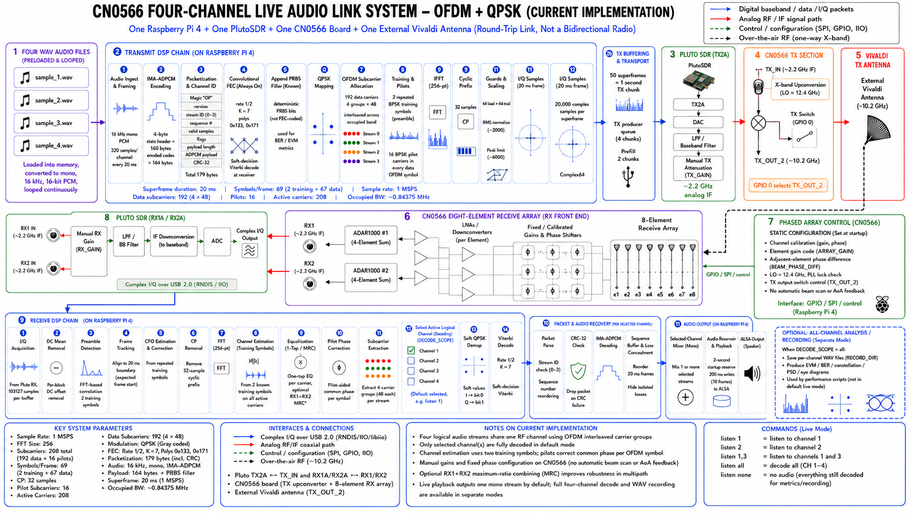

# CN0566 / Pluto Four-Channel QPSK-OFDM Audio

A Raspberry Pi 4 reference implementation that transmits four independent
16 kHz mono audio streams in one QPSK-OFDM waveform through an ADALM-Pluto SDR
and CN0566/ADALM-PHASER X-band front end.



## Current operating model

```text
sample_1.wav ┐
sample_2.wav ├-> packet/FEC/QPSK -> four interleaved OFDM carrier groups
sample_3.wav ┤                         -> one composite IFFT waveform
sample_4.wav ┘

Raspberry Pi 4 -> USB 2.0 / IIOD -> Pluto TX2A -> CN0566 TX_IN
               -> CN0566 TX_OUT_2 -> external Vivaldi antenna
               -> direct/reflected X-band path
               -> CN0566 eight-element receive array
               -> CN0566 RX2 -> Pluto RX2A -> Raspberry Pi 4
```

All four logical streams are transmitted in every 20 ms superframe. The public
realtime profile decodes only the logical channel or channels currently selected
for listening, which keeps the Raspberry Pi within its processing budget.

The four disjoint subcarrier groups are an OFDMA-like fixed allocation, but the
current laboratory application uses one physical receiver. A true multi-terminal
OFDMA experiment requires one compatible receiver terminal per user.

## Fixed hardware map

```text
Pluto TX2A         -> CN0566 TX_IN
CN0566 TX_OUT_2    -> external Vivaldi transmit antenna
CN0566 RX1         -> Pluto RX1A  (optional MRC)
CN0566 RX2         -> Pluto RX2A  (default realtime receive path)
```

## Stable 1 MSPS profile

| Parameter | Value |
|---|---:|
| Sample rate | 1 MSPS |
| FFT / cyclic prefix | 256 / 32 samples |
| Superframe | 20 ms / 20,000 samples |
| OFDM symbols/superframe | 69 total: 2 training + 67 data |
| Active carriers | 208 |
| Data / pilot carriers | 192 / 16 |
| Logical streams | 4 |
| Data carriers/stream | 48, interleaved across the occupied band |
| Modulation | Normalized QPSK |
| FEC | Rate-1/2, K=7, polynomials 0o133/0o171 |
| Packet | 179 bytes per stream per 20 ms |
| Occupied bandwidth | approximately 843.75 kHz |
| Pluto RF bandwidth | 1.25 MHz |
| Raw data-carrier rate | 1.333 Mbit/s |
| Rate-1/2 framed information rate | 643.2 kbit/s |
| Digital scaling | RMS 2000, peak limit 6000 |
| Default RX | RX2A |
| Default decode scope | selected logical channels |

Additional benchmark profiles are included:

| Profile | Fs | Framed rate-1/2 information | Status |
|---|---:|---:|---|
| `stable_1m` | 1.0 MSPS | 643.2 kbit/s | Default hardware profile |
| `balanced_1p5m` | 1.5 MSPS | 979.2 kbit/s | Test after stable pass |
| `high_2m` | 2.0 MSPS | 1.3056 Mbit/s | Experimental on Raspberry Pi 4 |

## Safety

This repository is prototype software, not regulatory authorization. Transmit
only in a shielded setup or where the selected X-band emission is authorized.
OFDM has a high peak-to-average power ratio. Start with conservative analog TX
attenuation and digital amplitude, confirm PLL lock and ADC headroom, and change
only one gain at a time.

The public `config.env` uses `TX_GAIN=-60` dB. A separate
`config.measured-direct-path.env` records the -40 dB setting that worked in one
specific direct-path laboratory geometry; it is not a universal safe default.

## Installation

The target image must already expose CN0566 through local IIO devices and Pluto
through the configured USB/RNDIS IIO context.

```bash
cd ~/Desktop
unzip cn0566-ofdm-qpsk-4ch-audio-v2.3.1.zip
cd cn0566-ofdm-qpsk-4ch-audio
chmod +x *.sh *.py
./setup_rpi.sh
```

The native `libcn0566_fec.so` is intentionally not committed. It is compiled on
the target system from `cn0566_fec.c`.

## Required acceptance sequence

```bash
./run_tests.sh
./run_simulation.sh
./run_realtime_benchmark.sh
./diagnose_iio.sh
./run_rf_sanity.sh
./run_ofdm_probe.sh
./run_ofdm_no_play.sh
./run_ofdm_audio.sh
```

Do not proceed to RF when simulation or the realtime benchmark fails.

### Software-only tests

```bash
./run_tests.sh
./run_simulation.sh
./run_all_profile_simulations.sh
```

A successful simulation recovers all four packet streams byte-for-byte.

### Realtime benchmark

```bash
./run_realtime_benchmark.sh
```

The stable profile must build TX chunks and process selected-channel RX data
faster than sample arrival. Hardware-free benchmark success does not guarantee
USB, RF or thermal stability, but a benchmark failure predicts backlog.

### RF sanity and cyclic OFDM probe

```bash
./run_rf_sanity.sh
./run_ofdm_probe.sh
```

The sanity script emits a profile-dependent cyclic tone. The OFDM probe repeats
a valid deterministic OFDM frame and separates RF/synchronization behavior from
live audio scheduling.

### Live no-play test

```bash
./run_ofdm_no_play.sh
```

Require approximately 50 frames/s, stable lock, zero host drops and zero TX
starvation before opening ALSA.

### Interactive audio

```bash
./run_ofdm_audio.sh
```

Commands while running:

```text
listen 1
listen 2
listen 1,3
listen all
listen none
status
help
quit
```

`listen all` requests all four decoders and may exceed the Raspberry Pi 4 live
budget. All four streams remain on air even when only one is decoded locally.

## Performance tests

### Application-level OFDM performance

```bash
./run_performance_sim.sh
./run_performance_hardware.sh
```

The existing tool generates per-channel constellation, derived eye, waveform,
spectrum, CSV metrics and `REPORT.txt`.

### Standard deterministic PRBS QPSK patterns

This release also integrates the waveform-level performance test that does not
read `sample_*.wav`:

```bash
./run_standard_pattern_performance_sim.sh
./run_standard_pattern_performance_hardware.sh
```

The four logical groups carry PRBS7, PRBS9, PRBS15 and PRBS23. Each run creates
a timestamped directory under `qpsk_pattern_performance_runs/` with exact BER,
SER, EVM, CFO, correlation, PSD, waveform and constellation results.

## Repository layout

```text
cn0566_ofdm_core.py                     OFDM, packet, audio and hardware core
cn0566_ofdm_4audio.py                   Four-stream realtime application
cn0566_fec.c                            Native FEC and IMA-ADPCM routines
cn0566_rf_sanity_ofdm.py                Profile-aware RF tone test
cn0566_ofdm_probe.py                    Cyclic valid-OFDM probe
cn0566_ofdm_performance.py              Application performance capture
cn0566_ofdm_qpsk_pattern_performance.py Standard PRBS PHY test
benchmark_rpi.py                        Software realtime budget measurement
config.env                              Conservative public configuration
run_*.sh                                Controlled launchers and interlocks
tests/                                  Twelve hardware-free tests
docs/                                   Design, migration and operation notes
assets/                                 System diagrams
```

## Limitations

- The current platform transmits through the external Vivaldi; the CN0566 onboard
  phased array is used on receive.
- Four logical subcarrier groups do not by themselves constitute four physical
  terminals or SDMA beams.
- The current implementation is a fixed-allocation OFDMA-like downlink waveform,
  not a complete multiuser association, encryption, scheduling, ACK or uplink
  protocol.
- RX2-only decoding is the stable realtime path. MRC adds USB and CPU load.
- The high-rate profiles require empirical Raspberry Pi and USB validation.
- Performance eye diagrams are derived from equalized QPSK decisions; raw OFDM
  does not have the same conventional matched-filter eye as single-carrier QPSK.

See [docs/OFDM_DESIGN.md](docs/OFDM_DESIGN.md),
[OPERATIONS.md](OPERATIONS.md), [TROUBLESHOOTING.md](TROUBLESHOOTING.md), and
[docs/STANDARD_PATTERN_PERFORMANCE.md](docs/STANDARD_PATTERN_PERFORMANCE.md).

## License and trademarks

The included `LICENSE` is a proposed MIT license. Review institutional ownership
and publication requirements before making the repository public. Analog
Devices and product names are marks of their respective owners. This repository
is an independent research prototype.
