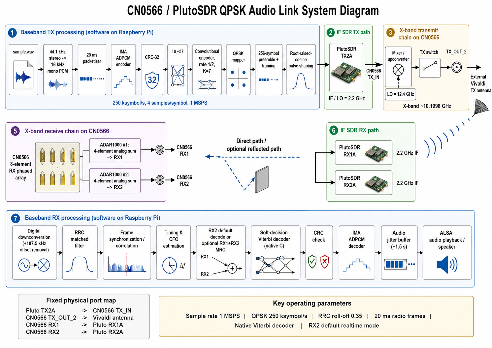

# CN0566 / Pluto Real-Time Single-Carrier QPSK Audio

A Raspberry Pi 4 reference implementation of a full-duplex laboratory audio
link using an Analog Devices CN0566/ADALM-PHASER assembly and a 2R2T-capable
ADALM-Pluto SDR.



## Signal path

```text
sample.wav
  -> 16 kHz mono PCM
  -> independent 20 ms IMA-ADPCM blocks
  -> packet header + CRC-32
  -> rate-1/2, K=7 convolutional FEC
  -> normalized single-carrier QPSK
  -> root-raised-cosine pulse shaping
  -> +187.5 kHz complex frequency offset
  -> Pluto TX2A at approximately 2.2 GHz IF
  -> CN0566 TX_IN / TX_OUT_2
  -> external Vivaldi X-band antenna
  -> direct or reflected path
  -> CN0566 eight-element receive array
  -> CN0566 RX1/RX2 analog subarray sums
  -> Pluto RX1A/RX2A
  -> synchronization, timing, CFO and channel correction
  -> RX2 decoding by default or optional two-channel MRC
  -> soft Viterbi + CRC + IMA-ADPCM
  -> ALSA playback
```

Fixed physical map:

```text
Pluto TX2A         -> CN0566 TX_IN
CN0566 TX_OUT_2    -> external Vivaldi antenna
CN0566 RX1         -> Pluto RX1A
CN0566 RX2         -> Pluto RX2A
```

## Default modem profile

| Parameter | Value |
|---|---:|
| Pluto sample rate | 1 MSPS |
| QPSK symbol rate | 250 ksymbol/s |
| Samples/symbol | 4 |
| RRC roll-off / span | 0.35 / 10 symbols |
| Approximate occupied bandwidth | 337.5 kHz |
| Digital frequency offset | +187.5 kHz |
| Pluto TX/RX LO | 2.2 GHz |
| CN0566 LO | 12.4 GHz |
| Nominal X-band center | 10.1998125 GHz |
| Audio | 16 kHz mono PCM internally |
| Air codec | Independent 4-bit IMA-ADPCM blocks |
| Audio interval | 20 ms / 320 samples |
| FEC | Rate-1/2, K=7, polynomials 0o133/0o171 |
| Packet integrity | CRC-32 |
| Preamble | 256 known QPSK symbols |
| TX chunk | 50 radio frames / 1 second |
| TX queue | Six prepared chunks; two-chunk startup prefill |
| Realtime RX | RX2A default; optional MRC |
| Audio startup reservoir | 1.5 seconds |

## Safety

This repository is prototype software, not regulatory authorization. Transmit
only in a shielded setup or where the selected frequency, bandwidth, power and
location are authorized. Start with high Pluto attenuation. Confirm PLL lock,
port routing and ADC headroom before increasing power. Never use a direct RF
coax loopback between amplified CN0566 transmit and receive paths.

## Raspberry Pi installation

The supported workflow assumes a CN0566-compatible Linux/Kuiper image in which
the local CN0566 IIO devices already enumerate.

```bash
cd ~/Desktop
unzip cn0566-single-carrier-qpsk-audio-v1.3.0.zip
cd cn0566-single-carrier-qpsk-audio
chmod +x *.sh *.py
./setup_rpi.sh
```

`setup_rpi.sh` installs Raspberry Pi OS scientific packages, creates a virtual
environment with system packages, installs the IIO Python bindings, compiles the
native Viterbi decoder, runs tests, and executes the non-RF simulation.

## Required validation order

```bash
./run_tests.sh
./run_simulation.sh
./run_qpsk_performance_simulation.sh
./run_rf_sanity.sh
./run_qpsk_no_play.sh
./run_qpsk_audio.sh
```

Do not proceed to RF if the software simulation fails.

### 1. Software-only simulation

```bash
./run_simulation.sh
```

Expected final line:

```text
Simulation passed: all packet payloads match exactly
```

### 2. RF sanity test

Review `config.env`, separate the antennas, and begin conservatively. Then:

```bash
./run_rf_sanity.sh
```

The launcher requires the exact confirmation text `QPSK_RF_TEST` and emits a
finite cyclic +187.5 kHz diagnostic tone. It restores Pluto TX attenuation to
-88 dB during cleanup.

### 3. Link without playback

```bash
./run_qpsk_no_play.sh
```

Healthy continuous operation approaches:

```text
rate=45..52/s
lock=1
host_drop=0
tx_starve=0
```

### 4. Live audio

After the no-play run is stable:

```bash
./run_qpsk_audio.sh
```

The receiver intentionally accumulates about 1.5 seconds of contiguous decoded
audio before opening ALSA.

## Configuration

Edit `config.env`. The public release defaults to `TX_GAIN=-60` dB for a more
conservative first test. The earlier measured direct-path setup used -40 dB,
but that value must not be copied blindly to a different geometry.

```bash
TX_GAIN="-60"
RX_GAIN="20"
ARRAY_GAIN="127"
BEAM_PHASE_DIFF="0.0"
DECODE_CHANNEL="rx2"
CORRELATION_THRESHOLD="0.18"
AUDIO_BUFFER_MS="1500"
```

`TX_GAIN=0` is maximum Pluto output, not zero output. Increase transmit level by
making the value less negative, one step at a time.

## PHY performance measurement

```bash
./run_qpsk_performance_simulation.sh
./run_qpsk_performance.sh
```

Each run creates a timestamped directory under `qpsk_performance_runs/` with:

- `REPORT.txt`
- frame-level CSV and JSON summaries
- original-versus-received waveform
- received/TX PSD
- preamble correlation
- corrected QPSK constellation
- derived QPSK decision eye
- optional compressed raw I/Q capture

The hardware launcher uses a deterministic cyclic probe so pre-FEC BER, SER and
EVM can be calculated against known symbols.

## Repository layout

```text
cn0566_qpsk_audio.py       Main audio modem and realtime runtime
cn0566_rf_sanity.py        Cyclic-tone RF-path test
cn0566_qpsk_performance.py Deterministic PHY measurement and plots
cn0566_viterbi.c           Native soft-decision Viterbi decoder
config.env                 Site-specific runtime settings
run_*.sh                   Simulation, RF and playback launchers
tests/                     Hardware-free unit/integration tests
docs/                      Architecture, operation and troubleshooting
calibration/               Optional hardware-specific calibration files
assets/                    Diagrams
```

## Limitations

- This is a prototype, not a production modem.
- The real-time profile assumes a stable approximately flat channel over the
  occupied bandwidth.
- The default receiver uses one four-element analog subarray sum (RX2A) to limit
  Raspberry Pi USB and CPU load.
- Optional MRC uses the two analog four-element sums; the board does not expose
  eight independent digital element channels.
- Exact end-to-end latency is not timestamped in the packet protocol.
- A decoded return may be dominated by direct local leakage rather than a
  reflector unless the experiment controls geometry and isolation.

See [docs/ARCHITECTURE.md](docs/ARCHITECTURE.md),
[docs/OPERATIONS.md](docs/OPERATIONS.md), and
[docs/TROUBLESHOOTING.md](docs/TROUBLESHOOTING.md).

## License and trademarks

The included `LICENSE` is a proposed MIT license for this GitHub release. Review
ownership and institutional requirements before public publication. Analog
Devices, ADALM-Pluto, ADALM-PHASER and CN0566 are names or marks of their
respective owners. This repository is an independent research prototype and is
not an official Analog Devices product.
